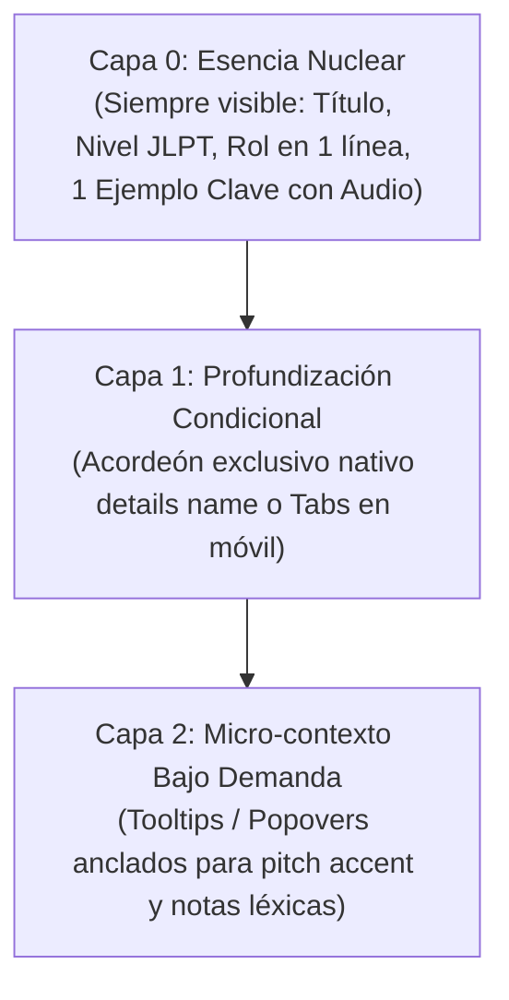

# Sistema de Diseño UI/UX: Tendencias, Estilo Japandi y Guía Global (2026)
*Nihongo Master — Estándar Visual, Arquitectura de Información, Tipografía CJK y Filosofía Estética*

---

## 1. Filosofía Central: "Ma" (間) y Minimalismo Japandi

La experiencia visual de **Nihongo Master** se rige por la unión entre el diseño funcional nórdico y la estética tradicional japonesa (*Japandi*):

1. **El Concepto de "Ma" (間 - Espacio Negativo Significativo)**:
   - El espacio vacío no es ausencia de contenido, sino un respiro intencional para la concentración mental y la reducción de la fatiga cognitiva.
   - **Prohibición de saturación**: Evitar saturar la pantalla con bloques masivos de texto, bordes pesados o exceso de botones en el primer plano visual.
   - Dejar respirar a los caracteres japoneses (`Kanji` y `Kana`), dándoles el protagonismo espacial que merecen.

2. **Estilo "Kawaii-Elegante" (Cute pero Maduro)**:
   - Inspirado en el diseño contemporáneo japonés (Muji, Studio Ghibli, Sanrio moderno y mascotas de prefecturas japonesas).
   - Figuras redondeadas (`border-radius: 12px–20px`), expresiones empáticas, proporciones suaves y acabados mate/arcilla (*clay*).
   - **No infantil**: No se utilizan colores chillones, fuentes de cómic o caricaturas caóticas. La paleta transmite serenidad, calidez y motivación.

---

## 2. Paleta Cromática Tradicional (*Dentou-iro* / 伝統色)

La paleta se inspira en los pigmentos naturales tradicionales de Japón, donde el color porta significado semántico y jerarquía:

| Rol Semántico | Nombre Tradicional | Código HEX (Claro) | Modo Oscuro Zen | Uso en la Aplicación |
| :--- | :--- | :--- | :--- | :--- |
| **Índigo Primario** | *Aizome* (藍染) | `#4338ca` / `#6366f1` | `#6366f1` / `#818cf8` | Botones de acción clave, navegación activa, marcas focales. |
| **Bermellón Zen** | *Shu-iro* (朱色) | `#e11d48` / `#f43f5e` | `#f43f5e` / `#fb7185` | Puertas Torii, muñecos Daruma 3D, sellos *Hanko*, rachas de fuego. |
| **Matcha Suave** | *Macha-iro* (抹茶色) | `#059669` / `#10b981` | `#10b981` / `#34d399` | Progreso completado, respuestas correctas, sincronización en la nube. |
| **Bambú / Ámbar** | *Kohaku-iro* (琥珀色) | `#d97706` / `#f59e0b` | `#f59e0b` / `#fbbf24` | Insignias oficiales JLPT (N5 a N1), advertencias y notas gramaticales. |
| **Papel Washi** | *Torinoko-iro* (鳥の子色)| `#FAF8F5` / `#F0EDE8` | `#090d16` / `#111827` | Lienzo base cálido (`--bg-washi-warm`), tarjetas elevadas (`--surface-washi-card`). |
| **Tinta Sumi** | *Sumi-iro* (墨色) | `#0f172a` / `#2c2c2c` | `#f1f5f9` / `#e2e8f0` | Tipografía de alto contraste, fondo base en Modo Oscuro Zen. |
| **Pétalo Sakura** | *Sakura-iro* (桜色) | `#fce7f3` / `#f472b6` | `#831843` / `#fce7f3` | Partículas de celebración, insignias de acierto y acentos suaves. |
| **Slate Fino** | *Sumi Usui* (薄墨) | `#E5E0D8` / `#e2e8f0` | `#1f2937` / `#374151` | Bordes sutiles de 1px (`--border-washi-fine`) y divisores. |

---

## 3. Tipografía CJK, Kinsoku Shori y Jerarquía

1. **Pila Tipográfica**:
   - Español e Interfaz: `'Inter', -apple-system, BlinkMacSystemFont, sans-serif`.
   - Japonés: `'Noto Sans JP', 'Hiragino Sans', 'Yu Gothic', sans-serif`.
2. **Kinsoku Shori & Quiebre Natural**:
   - Todo texto japonés (`:lang(ja)`, `.jp-text`, `.jp-content`) debe incorporar obligatoriamente:
     ```css
     word-break: auto-phrase;   /* Motor C++ BudouX en Chromium para quiebre en fronteras de frase */
     text-spacing-trim: normal; /* Calibración de puntuación CJK */
     letter-spacing: normal;    /* No aplicar letter-spacing latino a kanjis */
     ```
3. **Ritmo Vertical Diferenciado**:
   - Cuerpo de texto en japonés: `line-height: 1.75` y `font-size: calc(1em + 0.5px)` para evitar que el Furigana colisione.
   - Encabezados en japonés (`:lang(ja) h1–h3`, `.jp-heading`): `line-height: 1.3` y peso limitado a `font-weight: 500` (evitar 600/700 en kanjis complejos para no empastar los trazos).
4. **Calibración de `<ruby>` y `<rt>`**:
   ```css
   ruby {
     ruby-position: over;
     ruby-align: center;
     ruby-merge: separate;
   }
   rt {
     font-family: var(--font-jp);
     font-size: 0.54em;
     line-height: 1;
     color: var(--text-muted);
     user-select: none;
     transition: opacity 150ms ease-out;
   }
   ```

---

## 4. Adaptación Cognitiva FSRS (Zero Layout Shift)

1. **Principio**: El Furigana se atenúa o muestra según el estado de dominio individual del estudiante en el algoritmo FSRS v5 (`stability >= 21` días o `masteredKanji`).
2. **Regla de Oro de Rendimiento Visual (CLS < 0.1)**:
   - **NUNCA usar `display: none`** en las anotaciones fonéticas de kanjis dominados, ya que altera el ancho de la caja de línea y causa saltos visuales (*Cumulative Layout Shift*).
   - Usar exclusivamente `opacity: 0` en `rt.rt-mastered-hidden`:
     ```css
     rt.rt-mastered-hidden,
     .rt-mastered-hidden rt {
       opacity: 0;
       transition: opacity 150ms ease-out;
     }
     ruby:hover rt.rt-mastered-hidden,
     ruby:focus-within rt.rt-mastered-hidden,
     ruby.is-revealed rt.rt-mastered-hidden,
     .rt-mastered-hidden:hover rt,
     .rt-mastered-hidden:focus-within rt {
       opacity: 1;
     }
     ```
   - Al tocar o pasar el cursor, el Furigana se revela instantáneamente sin alterar el flujo del párrafo.

---

## 5. Arquitectura Bento Grid 2.0 y Conmutador de Densidad

1. **Regla de Atención Focal (1–2 Bloques Dominantes)**:
   - En cualquier pantalla (Dashboard, Currículum, Vocabulario), solo 1 o 2 bloques tienen protagonismo visual (bloque héroe 2x2 o `grid-column: span 8`), rodeados de bloques secundarios compactos (1x1).
   - Bordes limpios de `1px solid var(--border)` y micro-elevación suave (evitar sombras pesadas o difusas tipo `box-shadow` negras que saturan la pantalla).
2. **Conmutador Híbrido de Densidad (`[data-density]`)**:
   - **Compacto (`compact`)**: `--bento-gap: 12px`, `--bento-padding: 16px`, columnas reducidas (`minmax(220px, 1fr)`) para escanear muchas palabras o kanjis rápidamente.
   - **Cómodo (`comfortable` - Por defecto)**: `--bento-gap: 20px`, `--bento-padding: 24px`, balance ideal entre escaneo y calma visual.
   - **Espacioso (`spacious`)**: `--bento-gap: 28px`, `--bento-padding: 32px`, máxima presencia de *Ma* para reducir el estrés en conceptos complejos o principiantes de N5.
   - Disponible como selector global en [`SettingsModal.jsx`](file:///Users/danielgomez/Documents/Nihongo/components/modals/SettingsModal.jsx) y persistido en `appState.density`.

---

## 6. Arquitectura de Revelación Progresiva en 3 Capas

Para eliminar la verbosidad visual sin recortar el contenido educativo:



1. **Capa 0 (Esencia Nuclear)**:
   - Concepto central visible: símbolo de partícula, ideograma o patrón gramatical.
   - Rol funcional conciso en 1 línea con badge oficial JLPT (N5 a N1).
   - **Un único ejemplo canónico destacado** con controles directos de pronunciación y audio nativo.
2. **Capa 1 (Acordeones Nativos Exclusivos)**:
   - Secciones analíticas (fórmulas, reglas de formación, más ejemplos, excepciones) agrupadas en `<details name="capa-id" class="japandi-accordion">`.
   - **Exclusividad**: El atributo compartido `name` asegura que abrir una sección cierra automáticamente la anterior, manteniendo la altura compacta.
   - **Cero JavaScript**: Aprovecha `::details-content` y `interpolate-size: allow-keywords`.
   - **Búsqueda nativa (Ctrl+F)**: El navegador expande automáticamente la sección oculta al encontrar coincidencias.
3. **Capa 2 (Micro-contexto)**:
   - Notas morfológicas, diagramas de acento tonal (OJAD) o referencias secundarias mediante [`TerminologyTooltip.jsx`](file:///Users/danielgomez/Documents/Nihongo/components/common/TerminologyTooltip.jsx).

### Salvaguardas de Usabilidad:
* **Prohibición de Anidamiento**: Nunca anidar un `<details>` dentro de otro `<details>`. Los acordeones deben permanecer en un único nivel plano.
* **Salvaguarda de Comparación Simultánea**: Cuando se contrasten dos partículas (ej. は vs が) o cadenas de registro Keigo, se muestran en **paneles comparativos lado a lado (side-by-side)**, nunca obligando al estudiante a abrir y cerrar pestañas alternas.

---

## 7. Contrato de Movimiento Zen y Animaciones en Compositor

1. **Ejercicios y Flujo de Estudio**:
   - **Cero sacudidas (*shake*)**: Al errar una opción, no se sacude la pantalla ni se emiten ruidos violentos.
   - **Retroalimentación accesible sin color exclusivo**: Las opciones falladas añaden `textDecoration: 'line-through'` además del cambio de color, garantizando el cumplimiento de **WCAG 2.2 / JIS X 8341-3**.
   - **Excepción táctil móvil**: Pulsación con micro-compresión física `.primary-tap-target:active { transform: scale(0.97); opacity: 0.85; transition: 80ms }` en pantallas ≤768px.
2. **Animaciones en el Hilo Compositor (CSS)**:
   - **Barra de lectura a 60fps**: `@keyframes scrollProgressScale` con `animation-timeline: scroll(root block)`.
   - **Entrada suave de tarjetas**: `.bento-card-reveal` con `animation-range: entry 0% entry 30%` para que el contenido ya esté estático y legible al llegar el ojo del estudiante.
   - **Respeto a Accesibilidad**: Todas las animaciones envueltas estrictamente en `@media (prefers-reduced-motion: no-preference)`.
3. **Gamificación y Confeti**:
   - Prohibido lanzar confeti en preguntas individuales rutinarias.
   - El confeti se reserva exclusivamente para **hitos de sesión mayores** (completar un módulo de la ruta, aprobar un simulacro JLPT con éxito o superar una meta semanal).

---

## 8. Checklist Obligatorio para Todo Cambio o Nuevo Componente de UI

Antes de dar por completado cualquier rediseño o nueva pantalla:
- [ ] **Kinsoku Shori**: ¿El texto en japonés incluye `word-break: auto-phrase` y `text-spacing-trim: normal`?
- [ ] **Tipografía CJK**: ¿Los encabezados en japonés tienen `line-height: 1.3` y `font-weight: 500` (no 700)?
- [ ] **Furigana Zero-CLS**: ¿Se utiliza `rt.rt-mastered-hidden` con `opacity: 0` (y nunca `display: none`)?
- [ ] **3 Capas**: ¿La tarjeta muestra en superficie solo la esencia (Capa 0) y traslada la teoría a acordeones exclusivos `<details name="...">` (Capa 1)?
- [ ] **No-Anidamiento**: ¿Se evitaron acordeones dentro de acordeones?
- [ ] **Comparación Lado a Lado**: ¿Las comparativas entre partículas o Keigo se muestran lado a lado (*side-by-side*)?
- [ ] **Contrato Zen**: ¿Se evitaron sacudidas (*shake*), rebotes excesivos o confeti en preguntas individuales?
- [ ] **Densidad**: ¿El contenedor soporta los selectores de densidad `[data-density]`?
- [ ] **Accesibilidad**: ¿Los acordeones tienen `:focus-visible` de 2px y las opciones incorrectas tienen tachado `line-through`?
- [ ] **Estándar JLPT**: ¿Todas las insignias y filtros usan exclusivamente N5 a N1 (cero CEFR)?
